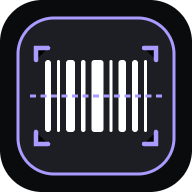

<!-- Improved compatibility of back to top link: See: https://github.com/othneildrew/Best-README-Template/pull/73 -->
<a id="readme-top"></a>

<!-- PROJECT SHIELDS -->
<!--
*** Reference links are enclosed in brackets [ ] instead of parentheses ( ).
*** See the bottom of this document for the declaration of reference variables
*** based on https://github.com/othneildrew/Best-README-Template.
-->
[![Contributors][contributors-shield]][contributors-url]
[![Forks][forks-shield]][forks-url]
[![Stargazers][stars-shield]][stars-url]
[![Issues][issues-shield]][issues-url]
[![MIT License][license-shield]][license-url]
[![Netlify Status][netlify-shield]][netlify-url]

<!-- PROJECT LOGO -->
<br />
<div align="center">
  <a href="https://github.com/briannl/FSA_Scanner">
    
  </a>

  <h3 align="center">FSA Scanner</h3>

  <p align="center">
    In-store barcode scanner and multi-retailer deal intelligence engine for FSA/HSA health products under IRS Section 213(d) and CARES Act Section 3702.
    <br />
    <a href="https://github.com/briannl/FSA_Scanner"><strong>Explore the docs »</strong></a>
    <br />
    <br />
    <a href="https://fsatracker.netlify.app">View Demo</a>
    &middot;
    <a href="https://github.com/briannl/FSA_Scanner/issues/new?labels=bug&template=bug-report---.md">Report Bug</a>
    &middot;
    <a href="https://github.com/briannl/FSA_Scanner/issues/new?labels=enhancement&template=feature-request---.md">Request Feature</a>
  </p>
</div>

<!-- TABLE OF CONTENTS -->
<details>
  <summary>Table of Contents</summary>
  <ol>
    <li>
      <a href="#about-the-project">About The Project</a>
      <ul>
        <li><a href="#key-capabilities">Key Capabilities</a></li>
        <li><a href="#built-with">Built With</a></li>
      </ul>
    </li>
    <li>
      <a href="#getting-started">Getting Started</a>
      <ul>
        <li><a href="#prerequisites">Prerequisites</a></li>
        <li><a href="#installation">Installation</a></li>
      </ul>
    </li>
    <li>
      <a href="#usage">Usage</a>
      <ul>
        <li><a href="#in-store-barcode-scanner">In-Store Barcode Scanner</a></li>
        <li><a href="#deal-intelligence--historical-price-trends">Deal Intelligence & Historical Price Trends</a></li>
        <li><a href="#scraping--sync-pipelines">Scraping & Sync Pipelines</a></li>
        <li><a href="#running-tests">Running Tests</a></li>
      </ul>
    </li>
    <li>
      <a href="#architecture--reliability">Architecture & Reliability</a>
      <ul>
        <li><a href="#repository-structure">Repository Structure</a></li>
        <li><a href="#resilience--reliability-principles">Resilience & Reliability Principles</a></li>
        <li><a href="#verification-matrix">Verification Matrix</a></li>
      </ul>
    </li>
    <li><a href="#roadmap">Roadmap</a></li>
    <li><a href="#contributing">Contributing</a></li>
    <li><a href="#license">License</a></li>
    <li><a href="#contact">Contact</a></li>
    <li><a href="#acknowledgments">Acknowledgments</a></li>
  </ol>
</details>

<!-- ABOUT THE PROJECT -->
## About The Project

Shopping in-store for Flexible Spending Account (FSA) and Health Savings Account (HSA) eligible products is fraught with guesswork: receipts often fail to categorize eligible healthcare items, retailer tags are outdated, and qualifying items rarely reflect active promotional discounts across competing stores.

**FSA Scanner** solves this problem by combining a zero-latency, camera-based in-store barcode scanner with a multi-retailer deal discovery and price-tracking engine. Powered by an eligibility evaluation engine complying with **IRS Section 213(d)** and **CARES Act Section 3702**, FSA Scanner tracks products across **CVS**, **Costco**, **Amazon**, **Ralphs**, **Vons**, and **Instacart**.

### Key Capabilities

* **Instant Camera & Manual Barcode Scanning:** Point your phone camera at any physical product UPC/EAN barcode to get instant FSA/HSA eligibility verdicts, qualifying legal rationales, and price comparisons without leaving the aisle.
* **Multi-Retailer Price Comparison:** Cross-reference current prices, historical lows, and digital coupons (e.g., CVS ExtraCare, Costco Instant Savings) across top retailers.
* **Offline-Ready PWA:** Full service-worker caching, local catalog lookups, and offline state handling ensure functionality inside deep retail concrete shells where cellular reception drops.
* **Zero Paid Dependencies:** Built without recurring cloud database fees, paid scraping proxies, or third-party LLM costs.

<p align="right">(<a href="#readme-top">back to top</a>)</p>

### Built With

This project is built on modern, resilient open-source tools:

* [![React][React.js]][React-url]
* [![TypeScript][TypeScript]][TypeScript-url]
* [![Vite][Vite]][Vite-url]
* [![AG Grid][AG-Grid]][AG-Grid-url]
* [![Playwright][Playwright]][Playwright-url]
* [![Netlify][Netlify]][Netlify-url]
* [![Recharts][Recharts]][Recharts-url]
* [![Vitest][Vitest]][Vitest-url]

<p align="right">(<a href="#readme-top">back to top</a>)</p>

<!-- GETTING STARTED -->
## Getting Started

To get a local development copy up and running, follow these steps.

### Prerequisites

* **Node.js**: v20 or higher (tested on Node v20+ and v25+)
* **npm**: v10 or higher
  ```sh
  npm install npm@latest -g
  ```

### Installation

1. Clone the repository:
   ```sh
   git clone https://github.com/briannl/FSA_Scanner.git
   cd FSA_Scanner
   ```
2. Install dependencies:
   ```sh
   npm install
   ```
3. Start the Vite development server:
   ```sh
   npm run dev
   ```
4. Open [http://localhost:5173](http://localhost:5173) in your browser.
   * Built-in Vite API middleware serves `/api/products` and `/api/refresh`.
   * An automatic local filesystem store saves data to `.data/blobs/`, requiring zero external database credentials for local runs.

<p align="right">(<a href="#readme-top">back to top</a>)</p>

<!-- USAGE EXAMPLES -->
## Usage

### In-Store Barcode Scanner

1. Open the app on your mobile browser or install it to your home screen as a PWA.
2. Navigate to the **Scan** tab and point your camera at any UPC-A, UPC-E, or EAN-13 barcode.
3. The scanner queries the cached catalog and returns:
   * **Eligibility Status:** Eligible, Eligible with Prescription (Rx), or Ineligible.
   * **Regulatory Citation:** IRS Section 213(d) / CARES Act Sec 3702 classification.
   * **Live Price Matrix:** Active prices and promo offers across CVS, Costco, Amazon, Ralphs, and Vons.
4. If camera permissions are unavailable or a barcode is torn, tap **Manual Entry** to type digits directly.

### Deal Intelligence & Historical Price Trends

* **AG Grid Data View:** Filter, sort, and export tracked products by retailer, category, stock status, discount percentage, and recent price drops.
* **Interactive Price Curves:** Tap any product observation to open the Recharts detail drawer, displaying all-time low reference markers, date-stamped price revisions, and active multi-buy conditions.

### Scraping & Sync Pipelines

To bypass aggressive retailer anti-bot protections (Akamai Bot Manager, Cloudflare) without running into serverless runtime timeouts, FSA Scanner provides three data collection channels:

#### Pipeline A: Automated GitHub Actions + Playwright (Recommended Cloud Path)
* Configured in `.github/workflows/scrape-deals.yml`.
* Runs on a 12-hour cron schedule (`0 */12 * * *`) and on-demand via `workflow_dispatch`.
* Executes headless Playwright Chromium with bot-masking (`navigator.webdriver` removal, realistic headers, randomized pacing).
* Posts verified snapshots to Netlify Blobs through `/api/refresh`.

**Manual GitHub Actions Trigger:**
1. Navigate to `https://github.com/briannl/FSA_Scanner/actions`.
2. Select **"Automated FSA Deal Discovery & Sync"**.
3. Click **"Run workflow"** on the `main` branch.

#### Pipeline B: Local Residential Terminal Sync (Bypass Datacenter IP Blocks)
When cloud datacenter IP ranges face Akamai or Cloudflare challenges, execute the Playwright collector directly from your home residential IP:

* **Against Local Dev Server:**
  ```sh
  npm run sync:playwright
  ```
* **Pushing Directly to Production Netlify:**
  * *macOS / Linux / Git Bash:*
    ```sh
    APP_URL="https://fsatracker.netlify.app" SYNC_SECRET_TOKEN="your-token" npm run sync:playwright
    ```
  * *Windows PowerShell:*
    ```powershell
    $env:APP_URL="https://fsatracker.netlify.app"
    $env:SYNC_SECRET_TOKEN="your-token"
    npm.cmd run sync:playwright
    ```

#### Pipeline C: 1-Click Browser Bookmarklet
1. Open the **Watchlist / Import** modal on the web app.
2. Drag the **"FSA Tracker Sync"** bookmarklet to your browser's bookmarks bar.
3. While browsing any product on `cvs.com` or `costco.com`, click the bookmarklet to extract live prices and push them directly to your dashboard.

### Running Tests

Execute the Vitest unit and integration test suite:

```sh
npm test
```

Build the production bundle and run TypeScript type checks:

```sh
npm run build
```

<p align="right">(<a href="#readme-top">back to top</a>)</p>

<!-- ARCHITECTURE & RELIABILITY -->
## Architecture & Reliability

### Repository Structure

```
FSA_Scanner/
├── .github/
│   └── workflows/
│       └── scrape-deals.yml           # GitHub Actions 12h cron & dispatch runner
├── scripts/
│   └── playwright-sync.ts             # Headless Chromium collector with bot-masking
├── src/
│   ├── components/
│   │   ├── BarcodeScannerModal.tsx    # ZXing camera video scanner with torch & reticle
│   │   ├── CompareOffersModal.tsx     # Cross-retailer price and savings comparison
│   │   ├── EditorialHomepage.tsx      # Curated deal discovery and category carousels
│   │   ├── MetricsBar.tsx             # Deal KPIs (active discounts, avg savings, drops)
│   │   ├── ProductDetailDrawer.tsx    # Recharts price history and all-time low curves
│   │   ├── ProductGrid.tsx            # AG Grid Community v33 data table
│   │   └── ScannerHome.tsx            # In-store search and fast-action barcode hub
│   ├── data/
│   │   ├── barcodeCatalog.ts          # Curated offline barcode & UPC reference database
│   │   └── seedData.ts                # Default seed catalog and price points
│   ├── services/
│   │   ├── FSAEligibilityEngine.ts    # IRS 213(d) / CARES Act 3702 decision rules
│   │   ├── ProductLookupService.ts    # Multi-source UPC resolver & localStorage cache
│   │   └── productMatcher.ts          # Normalizer across disparate retailer titles
│   ├── types/
│   │   ├── product.ts                 # ProductObservation & TrackerStatus models
│   │   └── scanner.ts                 # ScannedProduct & BarcodeLookupResult contracts
│   ├── App.tsx                        # Master app coordinator & tab navigator
│   └── main.tsx                       # React 18 bootstrap
├── netlify/
│   └── functions/
│       ├── products.ts                # GET /api/products (snapshots & metadata)
│       ├── refresh.ts                 # POST /api/refresh (batch ingestion & token auth)
│       └── shared/
│           ├── collector.ts           # Deduplication, price drops & history tracking
│           ├── costcoAdapter.ts       # Costco parser with HTTP 429 circuit breaker
│           ├── cvsAdapter.ts          # CVS parser with HTTP 403 Akamai breaker
│           └── storage.ts             # Netlify Blobs store + local .data/ fallback
├── tests/
│   ├── amazonRalphsAdapters.test.ts   # Amazon & Ralphs parser tests
│   ├── cameraLifecycle.test.ts        # Stream cleanup, torch controls & permissions
│   ├── circuitBreakerAndRateLimit.test.ts # 429/403 circuit breakers & retry limits
│   ├── fsafedsEligibility.test.ts     # FSAFEDS & IRS compliance verification
│   ├── inStoreScanner.test.ts         # In-store barcode scanning & caching logic
│   ├── multiStoreComparison.test.ts   # Multi-retailer best price calculations
│   └── storageAndCollection.test.ts   # Snapshot preservation & append-only histories
├── netlify.toml                       # Netlify build settings, headers & dev ports
├── vite.config.ts                     # Vite 6 config with API dev server middleware
└── tsconfig.json                      # Strict TypeScript compiler options
```

### Resilience & Reliability Principles

1. **Never Overwrite on Failure:** When a scraping job encounters an anti-bot challenge or returns zero items, existing valid snapshots in Netlify Blobs (`snapshot:cvs`, `snapshot:costco`, etc.) are strictly retained.
2. **Circuit Breakers:** Scrapers immediately abort remaining batch URLs on encountering HTTP 429 (rate-limited) or HTTP 403 (WAF block) responses to avoid burning IPs.
3. **Append-Only History:** All observed price points append immutably under `history:<product_id>`, ensuring accurate price-trend analytics over time.
4. **Token-Secured Webhook:** The `/api/refresh` endpoint requires a Bearer token matching `SYNC_SECRET_TOKEN` when defined in your environment variables.

### Verification Matrix

| Test Suite | Focus Area | Status | Verification Detail |
|---|---|:---:|---|
| **In-Store Barcode Scanner** | ZXing & Camera Lifecycle | **Passed** | Stream disposal on unmount, camera flip, torch toggling, and fast UPC cache |
| **FSAFEDS & IRS Eligibility** | Statutory Compliance | **Passed** | Verified against IRS 213(d), CARES Act 3702, and OTC medication rules |
| **Circuit Breakers & Rate Limits**| Retailer Anti-Bot Handling | **Passed** | Immediate queue shutdown on 429/403 without hammering remaining endpoints |
| **Multi-Store Comparison** | Cross-Retailer Normalization | **Passed** | Matcher groups identical items across CVS, Costco, Amazon, Ralphs, and Vons |
| **Storage & Snapshot Protection**| Netlify Blobs & Fallback | **Passed** | Prevents empty state overwrites, preserves history, and updates metadata |
| **Webhook Ingestion & Auth** | Netlify `/api/refresh` | **Passed** | Bearer token authorization, snapshot isolation, and price-drop recalculation |
| **Retailer Adapters** | HTML & JSON-LD Parsers | **Passed** | Extracts Instant Savings, ExtraCare coupons, and detects WAF block pages |

> **Test Suite Status:** 104 tests passing across 12 test suites.

<p align="right">(<a href="#readme-top">back to top</a>)</p>

<!-- ROADMAP -->
## Roadmap

- [x] In-store barcode scanner via mobile camera with ZXing
- [x] IRS Section 213(d) and CARES Act Section 3702 eligibility engine
- [x] Multi-retailer price comparison (CVS, Costco, Amazon, Ralphs, Vons, Instacart)
- [x] AG Grid Community v33 data grid with CSV export
- [x] Recharts price history visualization with all-time low markers
- [x] Headless Playwright automation pipeline with bot-masking
- [x] Netlify Blobs cloud persistence with local filesystem fallback
- [x] Offline PWA service worker with offline state indicators
- [ ] OCR receipt scanning to batch audit physical paper receipts
- [ ] Push notifications for custom watchlist price drops
- [ ] Barcode lookup integration with Open Food Facts / UPCitemdb API fallback

See the [open issues](https://github.com/briannl/FSA_Scanner/issues) for a full list of proposed features and known issues.

<p align="right">(<a href="#readme-top">back to top</a>)</p>

<!-- CONTRIBUTING -->
## Contributing

Contributions make the open source community an incredible space to learn, inspire, and create. Any contributions you make are **greatly appreciated**.

If you have a suggestion to improve FSA Scanner, please fork the repo and create a pull request. You can also open an issue tagged `"enhancement"`.

1. Fork the Project
2. Create your Feature Branch (`git checkout -b feature/AmazingFeature`)
3. Commit your Changes (`git commit -m 'Add some AmazingFeature'`)
4. Push to the Branch (`git push origin feature/AmazingFeature`)
5. Open a Pull Request

### Top Contributors

<a href="https://github.com/briannl/FSA_Scanner/graphs/contributors">
  
</a>

<p align="right">(<a href="#readme-top">back to top</a>)</p>

<!-- LICENSE -->
## License

Distributed under the MIT License. See `LICENSE` for more information.

<p align="right">(<a href="#readme-top">back to top</a>)</p>

<!-- CONTACT -->
## Contact

Brian - [@briannl](https://github.com/briannl)

Project Link: [https://github.com/briannl/FSA_Scanner](https://github.com/briannl/FSA_Scanner)

Live Demo: [https://fsatracker.netlify.app](https://fsatracker.netlify.app)

<p align="right">(<a href="#readme-top">back to top</a>)</p>

<!-- ACKNOWLEDGMENTS -->
## Acknowledgments

* [Best-README-Template by othneildrew](https://github.com/othneildrew/Best-README-Template)
* [IRS Publication 502 / Section 213(d)](https://www.irs.gov/publications/p502)
* [FSAFEDS Eligible Healthcare Products](https://www.fsafeds.com)
* [AG Grid Community](https://www.ag-grid.com)
* [Recharts](https://recharts.org)
* [ZXing (Zebra Crossing) Barcode Scanner for JS](https://github.com/zxing-js/library)
* [Playwright](https://playwright.dev)
* [Netlify Blobs & Functions](https://docs.netlify.com/blobs/overview/)
* [Shields.io Badges](https://shields.io)

<p align="right">(<a href="#readme-top">back to top</a>)</p>

<!-- MARKDOWN LINKS & IMAGES -->
<!-- https://www.markdownguide.org/basic-syntax/#reference-style-links -->
[contributors-shield]: https://img.shields.io/github/contributors/briannl/FSA_Scanner.svg?style=for-the-badge
[contributors-url]: https://github.com/briannl/FSA_Scanner/graphs/contributors
[forks-shield]: https://img.shields.io/github/forks/briannl/FSA_Scanner.svg?style=for-the-badge
[forks-url]: https://github.com/briannl/FSA_Scanner/network/members
[stars-shield]: https://img.shields.io/github/stars/briannl/FSA_Scanner.svg?style=for-the-badge
[stars-url]: https://github.com/briannl/FSA_Scanner/stargazers
[issues-shield]: https://img.shields.io/github/issues/briannl/FSA_Scanner.svg?style=for-the-badge
[issues-url]: https://github.com/briannl/FSA_Scanner/issues
[license-shield]: https://img.shields.io/badge/License-MIT-blue.svg?style=for-the-badge
[license-url]: https://github.com/briannl/FSA_Scanner/blob/main/LICENSE
[netlify-shield]: https://img.shields.io/badge/Netlify-Deployed-00ad9f.svg?style=for-the-badge&logo=netlify
[netlify-url]: https://fsatracker.netlify.app

<!-- Tech Badges -->
[React.js]: https://img.shields.io/badge/React_18-20232A?style=for-the-badge&logo=react&logoColor=61DAFB
[React-url]: https://react.dev/
[TypeScript]: https://img.shields.io/badge/TypeScript-3178C6?style=for-the-badge&logo=typescript&logoColor=white
[TypeScript-url]: https://www.typescriptlang.org/
[Vite]: https://img.shields.io/badge/Vite_6-646CFF?style=for-the-badge&logo=vite&logoColor=white
[Vite-url]: https://vite.dev/
[AG-Grid]: https://img.shields.io/badge/AG_Grid_v33-E0234E?style=for-the-badge&logo=aggrid&logoColor=white
[AG-Grid-url]: https://www.ag-grid.com/
[Playwright]: https://img.shields.io/badge/Playwright-2EAD33?style=for-the-badge&logo=playwright&logoColor=white
[Playwright-url]: https://playwright.dev/
[Netlify]: https://img.shields.io/badge/Netlify_Blobs_%26_Functions-00C7B7?style=for-the-badge&logo=netlify&logoColor=white
[Netlify-url]: https://docs.netlify.com/
[Recharts]: https://img.shields.io/badge/Recharts-22b5bf?style=for-the-badge
[Recharts-url]: https://recharts.org/
[Vitest]: https://img.shields.io/badge/Vitest-6E9F18?style=for-the-badge&logo=vitest&logoColor=white
[Vitest-url]: https://vitest.dev/
